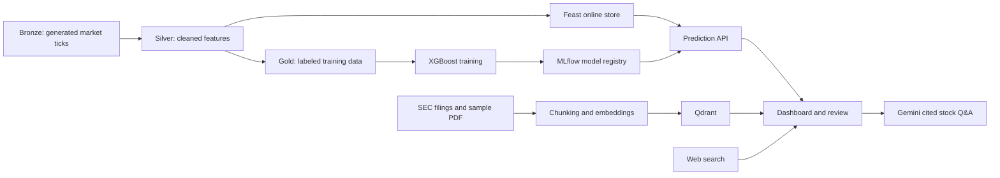

# Autonomous Financial Risk & Portfolio Management Engine

A local demonstration of a financial-risk workflow that combines a quantitative
model, SEC filing retrieval, web search, review controls, and an operations
dashboard. It is a learning/demo project, not a production investment system.
It does not place trades.


## Demo

https://github.com/user-attachments/assets/db15ba28-23dd-4543-bf7e-664d891b8a1a


## What it does

- **Risk assessment:** gets sample market features from Feast, scores them with
  an XGBoost model registered in MLflow, retrieves supporting filing passages,
  and searches recent news.
- **Stock Q&A:** retrieves ticker-filtered evidence from Qdrant and generates
  cited answers with Gemini. For an unindexed ticker, it can fetch recent public
  SEC filings, cache them, and index their text automatically.
- **Human review:** lets a reviewer approve or reject assessments that require
  review. Approval is a workflow decision only; no trade is placed.
- **Monitoring:** records assessment summaries and review decisions locally and
  displays their history in the dashboard.

## Agentic AI assessment workflow

The assessment workflow is a LangGraph state graph. Three specialist nodes run
in parallel, add their reports to shared workflow state, and pass the results to
the lead risk orchestrator. The nodes use explicit tools and rules; they do not
autonomously choose tools or negotiate with one another. Gemini is used for the
separate, cited stock Q&A experience.

| Role | Responsibility | How its output is used |
| --- | --- | --- |
| **Quantitative Risk Agent** | Calls the prediction API, which retrieves Feast features and returns the XGBoost risk probability and feature values. | Required input to the composite risk score. If unavailable, the assessment is blocked. |
| **Filing Audit Agent** | Searches the existing Qdrant index for up to two ticker-filtered SEC filing chunks about supply-chain, litigation, and regulatory risk. | Shows qualitative evidence for the reviewer. These passages do not currently change the numeric score, and this agent does not fetch filings itself. |
| **Market Sentiment Agent** | Searches the web for recent company news and returns headlines, snippets, and links. | Provides context for the reviewer. News is not sentiment-scored, so it does not change the numeric score. |
| **Lead Risk Orchestrator** | Checks that a valid quantitative score exists, combines it with a separately supplied sentiment score if one exists, assigns a risk level, and decides whether review is required. | Blocks the workflow if the quantitative score is missing. Otherwise, scores at or above 0.50 require human review; at or above 0.70 are Critical. With the current unscored news tool, the composite score is the quantitative probability. |
| **Human Governance** | Pauses high and critical assessments and waits for an explicit reviewer approval or rejection. | A rejection blocks clearance and records the review note. Checkpoints are in memory and are lost if the dashboard restarts. |
| **Execution / Decision Node** | Checks the quantitative result and review decision, then writes the final workflow status and summary. | It does not place orders or execute trades; “ready” and “approved” are workflow statuses only. |

The first three roles run concurrently, then the orchestrator routes the result
to human review when the score requires it. Low and medium scores proceed
directly to the final decision node. The filing and news reports remain visible
as evidence even though the current scoring logic does not treat them as
validated numeric risk signals.



## Requirements

- Docker Desktop with Docker Compose
- A Google AI Studio API key for Gemini-generated Q&A
- A contact email for automatic SEC EDGAR downloads

The dashboard and local services run in containers. No local Python virtual
environment is required for the Docker workflow.

## First run

From PowerShell at the repository root:

```powershell
Set-Location .\financial-engine
if (-not (Test-Path .env)) { Copy-Item .env.example .env }
```

Edit `financial-engine/.env` and set:

```dotenv
GEMINI_API_KEY=your_google_ai_studio_key
SEC_USER_AGENT=FinancialRiskDashboard your-real-email@example.com
```

The SEC contact is needed only when the app downloads filings automatically.
The Gemini key is needed to generate natural-language Q&A answers. Keep `.env`
private; it is excluded from Git.

Build and train the demo model once before starting the full application:

```powershell
docker compose --profile training run --build --rm train-model
docker compose up --build -d
```

The training command generates the demo market data, builds the Silver and Gold
datasets, validates Silver, registers and materializes Feast features, trains
XGBoost, and promotes the new model as the MLflow `champion` alias. It writes
runtime data and model artifacts under `financial-engine/data/` and
`financial-engine/mlartifacts/` on the host.

The regular Compose stack starts the prediction API, dashboard, MLflow, Qdrant,
and a one-shot job that indexes the sample filing in
`financial-engine/data/filings/`.

## Open the application

- Dashboard: <http://localhost:8501>
- Prediction API documentation: <http://localhost:8000/docs>
- MLflow: <http://localhost:5000>
- Qdrant dashboard: <http://localhost:6333/dashboard>

In the dashboard, **Assessment** runs the risk workflow, **Ask about a stock**
answers questions grounded in a ticker's filings, and **Monitoring** shows
assessment and review history. For a new ticker, the first Q&A request triggers
the SEC filing download and indexing flow. The sample PDF currently covers
NEXA. The retrieval pipeline supports selectable-text PDF, HTML, CSV, Markdown,
and text files; it does not OCR scanned PDFs.

Check service state and logs from `financial-engine`:

```powershell
docker compose ps
docker compose logs -f dashboard
```

Stop services while retaining the Qdrant and embedding-model volumes:

```powershell
docker compose down
```

`docker compose down -v` also deletes named Docker volumes, including the local
Qdrant index and downloaded embedding model cache.

## Data pipeline

The market-data pipeline is:

1. **Bronze** — `src/data_pipeline/ingest.py` generates synthetic
   market ticks for AAPL, GOOGL, MSFT, AMZN, and NVDA.
2. **Silver** — `src/data_pipeline/transform.py` cleans and adds rolling-volume,
   price-change, and composite-risk features. `validate.py` checks required
   values and ranges.
3. **Gold** — `src/data_pipeline/gold.py` selects model inputs, creates the
   binary `target_high_risk` label using the median composite-risk value by
   default, and records the threshold in the training dataset. Set
   `RISK_LABEL_THRESHOLD` to choose a fixed threshold for a run.
4. **Online serving** — `src/data_pipeline/materialize_features.py` registers
   Feast definitions and materializes Silver feature rows into the SQLite online
   store used by the prediction API.
5. **Training and registry** — `src/ml_pipeline/train.py` trains the model from
   Gold and logs metrics and model artifacts to MLflow. `set_alias.py` promotes
   the latest registered version to `champion`.

Gold is generated output and stays out of Git. The sample PDF is included in
the repository. Downloaded SEC filings, monitoring and Feast databases,
generated parquet files, and MLflow model artifacts are local runtime data.
The repository still contains a tracked `financial-engine/mlflow.db` metadata
snapshot; run the training bootstrap above to register model artifacts for a
checkout before starting the prediction API. That database snapshot should be
removed from Git before publishing a clean release.

## SEC filings and retrieval

The Q&A view retrieves only chunks matching the selected ticker and includes
source citations. If no indexed chunks exist, it looks up the ticker in SEC
EDGAR, fetches the latest annual and interim filings it supports, caches them
under `financial-engine/data/sec_filings/`, then indexes them in Qdrant. The SEC
cache is considered fresh for seven days. Use **Refresh SEC filings** to check
for newer filings for a ticker that is already indexed.
The app uses the public SEC filing APIs and does not require an SEC API key.

The SEC requires automated clients to identify themselves. Set
`SEC_USER_AGENT` to an application name and a valid contact address, and follow
the SEC's [fair access guidance](https://www.sec.gov/about/webmaster-frequently-asked-questions).
The SEC API details are documented
[here](https://www.sec.gov/search-filings/edgar-application-programming-interfaces).

Q&A answers are generated from retrieved filing excerpts, with citation markers
and links to SEC sources where available. It does not supply live stock prices,
price forecasts, or current news answers. News results appear in the assessment
workflow and are not scored as sentiment.

## Configuration

`financial-engine/.env.example` lists supported environment settings. Common
options include:

| Variable | Purpose |
| --- | --- |
| `GEMINI_API_KEY` | Google AI Studio API key for generated Q&A |
| `GEMINI_MODEL` | Primary Gemini model ID |
| `GEMINI_FALLBACK_MODELS` | Comma-separated fallback model IDs |
| `GEMINI_TEMPERATURE` | Generation temperature where supported |
| `GEMINI_MAX_OUTPUT_TOKENS` | Maximum generated answer length |
| `SEC_USER_AGENT` | SEC client identification and contact address |
| `QDRANT_COLLECTION` | Qdrant collection name |
| `SENTENCE_TRANSFORMER_MODEL` | Embedding model used for indexing and retrieval |
| `WEB_SEARCH_MAX_RESULTS` | Maximum search results for an assessment |
| `RISK_LABEL_THRESHOLD` | Optional fixed Silver-to-Gold label cutoff; defaults to the median |

Google's [Gemini API model documentation](https://ai.google.dev/gemini-api/docs/models)
currently marks Gemini 2.5 Flash as a legacy model: access is limited to existing
users, with API requests routing to Gemini 3.5 Flash-Lite from December 1, 2026.
The example fallback list retains Gemini 2.5 Flash for compatibility with
existing users; replace it with `gemini-3.5-flash-lite` for a new setup.

## Limitations

- Market ticks are generated synthetic values, not live or historical market
  prices. The risk labels are derived from a composite feature rather than
  verified future outcomes, so training metrics do not demonstrate real-world
  predictive performance.
- Online Feast features only exist for the generated sample tickers unless the
  ingestion pipeline is connected to a real market data source.
- SEC filings describe company disclosures; they do not guarantee that retrieval
  finds every relevant passage. Answers should be checked against their cited
  filings.
- Human-review checkpoints are held in memory and do not survive a dashboard
  process restart. Assessment summaries and review notes are stored in a local
  SQLite database, but the Monitoring page does not measure accuracy or drift
  because verified outcomes are not collected.
- The project is a local demo, not a regulated financial service. Do not use its
  outputs as investment advice or automated trading instructions.

## Tests

For local development, create a virtual environment and install dependencies
from `financial-engine`:

```powershell
python -m venv venv
.\venv\Scripts\python.exe -m pip install -r requirements.txt
```

Then run the unit tests:

```powershell
.\venv\Scripts\python.exe -m unittest discover -s tests -v
```

Some integration tests require local Feast, MLflow, Qdrant, model, or API
configuration. The Docker workflow is the intended way to run all services
together.
